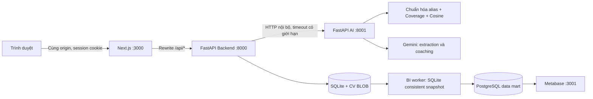
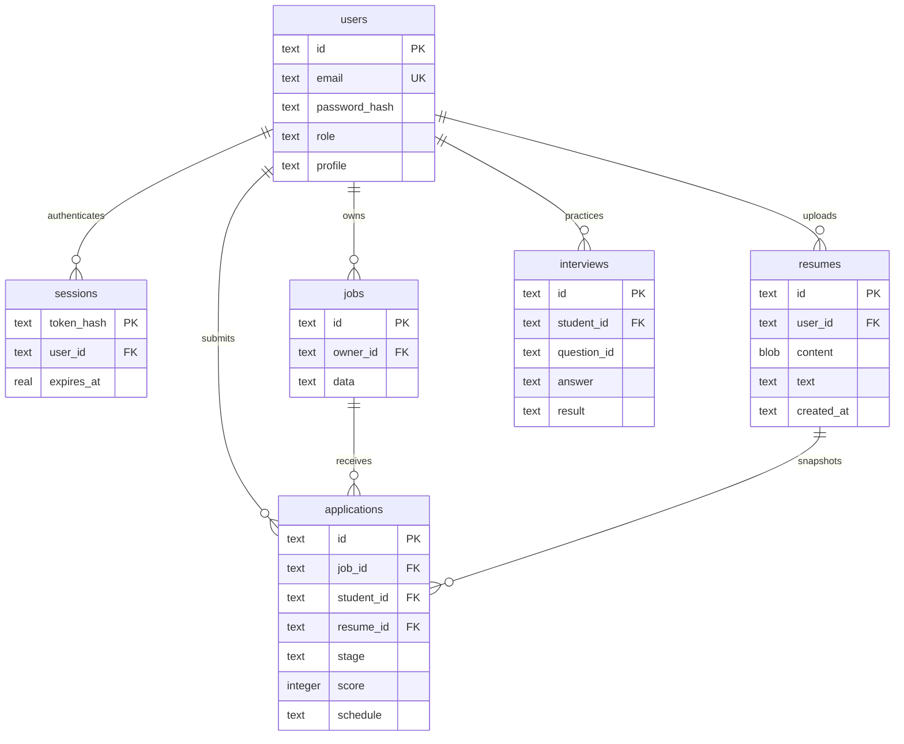

# Kiến trúc ứng dụng

## Ứng dụng và data mart trong một repository

Source hiện tại: `apps/web`, `services/api`, `services/ai`. Cùng đọc duy nhất `.env` ở root, dữ liệu local tại `var/data`, báo cáo kiểm thử tại `artifacts`. Cổng trong sơ đồ bên dưới là giá trị mặc định và có thể đổi trong `.env`. Xem [configuration.md](configuration.md) và [project-layout.md](project-layout.md).

Frontend gọi `/api/*` cùng origin; backend kiểm tra quyền và lưu SQLite. AI không truy cập DB; matching local không gửi kho CV ra ngoài, còn phân tích CV và coaching gọi Gemini từ payload người dùng chủ động gửi. Lỗi AI trả 503, không tạo kết quả Gemini giả. Matching cache theo hash toàn bộ input 60 giây, tối đa 16 batches; CV/profile/job thay đổi tạo key mới. Đăng nhập/đọc đơn không phụ thuộc AI.

Docker mở web :3000 và Metabase :3001 trên loopback; API/AI/PostgreSQL chỉ trong network. Test dùng project/volume riêng, cổng :3100/:3101.

## Mô hình nghiệp vụ cơ sở và migration version 4

ERD mở rộng, dictionary, origin và metric: [requirements-and-data.md](requirements-and-data.md). Sơ đồ dưới là quan hệ nghiệp vụ cốt lõi; v4 bổ sung extraction có xác nhận, prediction snapshots và entity metadata bên cạnh skills/coaching/stage events.

`users.profile`, `jobs.data`, `applications.schedule`, `interviews.result` là JSON trong TEXT. `applications` còn có `created_at`, `updated_at`; unique `(job_id, student_id)` chống đơn trùng. Timestamp được lưu UTC ISO 8601, giao diện đổi về múi giờ trình duyệt. Ngày/giờ hẹn phỏng vấn là giờ Việt Nam do người tuyển dụng nhập.

## Luồng ứng tuyển

1. Sinh viên cập nhật hồ sơ và tải PDF; backend kiểm định file, trích text, lưu record CV mới.
2. Khi lấy jobs, backend ghép hồ sơ + CV gần nhất rồi gọi AI để tính điểm riêng theo người đăng nhập.
3. Khi nộp đơn, backend kiểm tra role, job tồn tại, CV tồn tại; gọi AI và lưu điểm tại thời điểm gửi.
4. Application tham chiếu `resume_id` bất biến. Upload CV mới không đổi CV của đơn cũ.
5. Recruiter lấy đơn qua join `jobs.owner_id = current_user.id`, tải đúng CV đính kèm.
6. Recruiter đổi stage / lịch; sinh viên làm mới để đọc kết quả. Chưa có WebSocket, push hoặc email.

## BI và AI

Web BI đọc SQLite bằng owner scope; ETL đồng bộ snapshot đã chuẩn hóa sang PostgreSQL. Metabase bootstrap 6 câu hỏi/dashboard, dùng role chỉ đọc view tổng hợp. Real/demo/test tách biệt; currency/period tách riêng, thời gian lấy ngày đăng gốc. Chi tiết grain, quyền, refresh và recovery: [bi-and-recovery.md](bi-and-recovery.md).

Matching hybrid-v2 dùng kỹ năng/cosine và logistic weights; artifact thử nghiệm TF-IDF v3 được chọn bằng validation, hiện không đạt nên chưa triển khai. [Benchmark](../../data/evaluation/README.md) tách 576 mẫu synthetic thành train/validation/test; chưa có human gold. Gemini trích CV có câu bằng chứng, người dùng chỉnh/xác nhận; OCR Poppler/Tesseract tối đa 3 trang khi không có text. Lộ trình/câu hỏi/chấm phỏng vấn dùng Gemini. GitHub là liên kết khai báo, không thực thi mã người dùng.

## Quyết định kỹ thuật

- SQLite giúp chạy nhanh trên Windows mà không cài PostgreSQL; CV BLOB thuận tiện snapshot, sao lưu và quyền tải xuống.
- Session opaque giúp logout thu hồi ngay; không đưa bearer token vào JS storage.
- Ba package độc lập nhưng dùng chung Python virtual environment ở local để giảm cài đặt.
- Gemini cần key riêng trong `.env`; model mặc định `gemini-3.5-flash-lite`. Matching local hỗ trợ xếp hạng nhiều job mà không gọi LLM từng tin.
- Không di chuyển `docs/`, `scripts/research/`, `media/` đang có để bảo toàn đường dẫn báo cáo/video và script nghiên cứu.

## Phần cần bổ sung trước khi mở rộng

Migration có kiểm soát, PostgreSQL khi nhiều tác vụ ghi, object storage riêng cho CV, background worker trích PDF, rate limit, quản trị tài khoản, khôi phục mật khẩu, xóa dữ liệu cá nhân, quan sát vận hành và bộ dữ liệu đánh giá AI. Danh sách đầy đủ ở [trạng thái triển khai](implementation-status.md).
