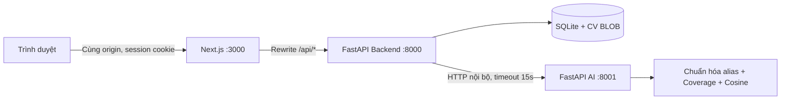
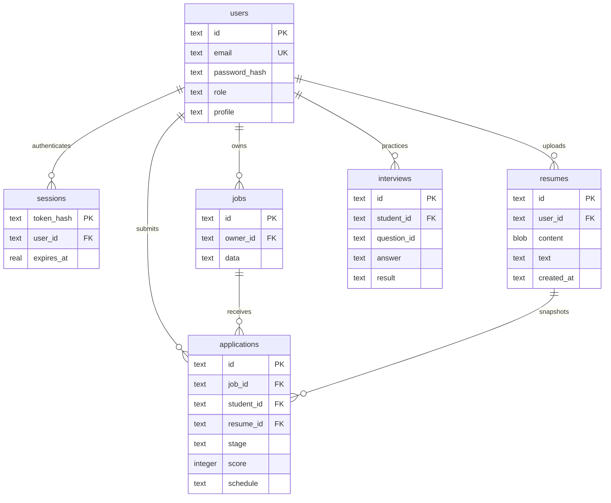

# Kiến trúc ứng dụng

## Ba dịch vụ trong một repository

Source hiện tại: `apps/web`, `services/api`, `services/ai`. Cùng đọc duy nhất `.env` ở root, dữ liệu local tại `var/data`, báo cáo kiểm thử tại `artifacts`. Cổng trong sơ đồ bên dưới là giá trị mặc định và có thể đổi trong `.env`. Xem [configuration.md](configuration.md) và [project-layout.md](project-layout.md).

Frontend gọi đường dẫn tương đối `/api/*`; proxy giữ cùng origin nên không cần token ở localStorage hoặc CORS rộng. Backend thực thi quyền và lưu dữ liệu; AI chỉ tính toán từ payload, không có kết nối tới DB hoặc Internet. Khi AI dừng, các thao tác cần AI trả 503; API health báo `degraded`, giao diện có thông báo và thử lại. Đăng nhập/đọc đơn không phụ thuộc AI.

Trong Docker, chỉ frontend mở cổng ra host; backend và AI giao tiếp bằng tên service. Khi dev, API và AI bind `127.0.0.1`.

## Mô hình dữ liệu SQLite version 1

`users.profile`, `jobs.data`, `applications.schedule`, `interviews.result` là JSON trong TEXT. `applications` còn có `created_at`, `updated_at`; unique `(job_id, student_id)` chống đơn trùng. Timestamp được lưu UTC ISO 8601, giao diện đổi về múi giờ trình duyệt. Ngày/giờ hẹn phỏng vấn là giờ Việt Nam do người tuyển dụng nhập.

## Luồng ứng tuyển

1. Sinh viên cập nhật hồ sơ và tải PDF; backend kiểm định file, trích text, lưu record CV mới.
2. Khi lấy jobs, backend ghép hồ sơ + CV gần nhất rồi gọi AI để tính điểm riêng theo người đăng nhập.
3. Khi nộp đơn, backend kiểm tra role, job tồn tại, CV tồn tại; gọi AI và lưu điểm tại thời điểm gửi.
4. Application tham chiếu `resume_id` bất biến. Upload CV mới không đổi CV của đơn cũ.
5. Recruiter lấy đơn qua join `jobs.owner_id = current_user.id`, tải đúng CV đính kèm.
6. Recruiter đổi stage / lịch; sinh viên làm mới để đọc kết quả. Chưa có WebSocket, push hoặc email.

## BI và AI

BI hiện đọc trực tiếp SQLite, tính tỷ lệ tin có nhãn kỹ năng và sinh viên khai báo đúng nhãn đó. Nguồn dữ liệu nhỏ, bao gồm seed; không đại diện cho thị trường lao động thực. Không ETL hoặc Star Schema vật lý trong MVP. Sơ đồ Star Schema DOCX là thiết kế nghiên cứu.

AI sử dụng từ điển kỹ năng và cosine bag-of-words; công thức ở [AI README](../../services/ai/README.md). Lộ trình được tạo từ các kỹ năng chưa nhận diện. Thông tin GitHub chỉ là liên kết do người dùng khai báo; ứng dụng không clone repo hoặc thực thi mã nguồn do người dùng gửi.

## Quyết định kỹ thuật

- SQLite giúp chạy nhanh trên Windows mà không cài PostgreSQL; CV BLOB thuận tiện snapshot, sao lưu và quyền tải xuống.
- Session opaque giúp logout thu hồi ngay; không đưa bearer token vào JS storage.
- Ba package độc lập nhưng dùng chung Python virtual environment ở local để giảm cài đặt.
- Không dùng model bên ngoài để tránh khóa API và chi phí cho bài tập; API cho phép thay engine về sau.
- Không di chuyển `docs/`, `scripts/research/`, `media/` đang có để bảo toàn đường dẫn báo cáo/video và script nghiên cứu.

## Phần cần bổ sung trước khi mở rộng

Migration có kiểm soát, PostgreSQL khi nhiều tác vụ ghi, object storage riêng cho CV, background worker trích PDF, rate limit, quản trị tài khoản, khôi phục mật khẩu, xóa dữ liệu cá nhân, quan sát vận hành và bộ dữ liệu đánh giá AI. Danh sách đầy đủ ở [trạng thái triển khai](implementation-status.md).
