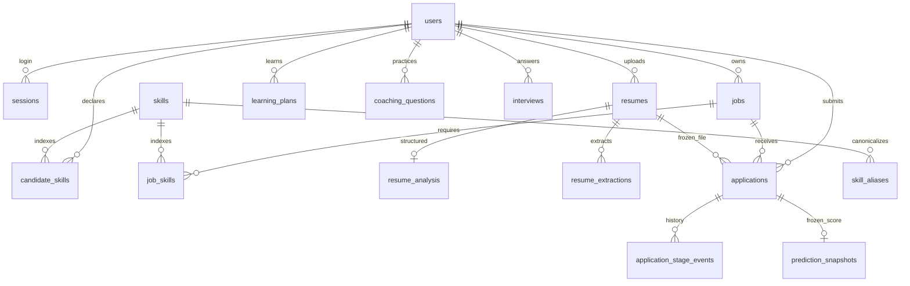

# Yêu cầu và dữ liệu TH3

Ngày cập nhật: 04/11/2026. Đây là đặc tả bản triển khai, không phải cam kết độ chính xác tuyển dụng.

| Yêu cầu | Luồng/API | Bằng chứng tự động |
|---|---|---|
| FR01 Đăng ký/đăng nhập/phân quyền | `/auth/*`, cookie session, guard student/recruiter | authentication E2E, workflow unit |
| FR02 Hồ sơ và CV | `/profile`, `/resumes`, chỉ PDF ≤5 MB/30 trang | matrix PDF hỏng/rỗng/password/prefix/font, persistence E2E |
| FR03 Phân tích có bằng chứng | POST `/resumes/{id}/analyze`, PATCH `…/analysis` | Gemini live E2E, OCR scan E2E, evidence/ownership unit |
| FR04 Tìm việc và giải thích | `/jobs/search`, `/jobs/{id}` | filter/page validation, match detail E2E |
| FR05 Ứng tuyển bất biến CV | POST `/applications`, GET CV theo đơn | E2E hash file sau thay CV, snapshot prediction unit |
| FR06 Tuyển dụng | đăng tin, candidate search/detail, stage/schedule | 2-user E2E, outsider bị 404 |
| FR07 BI | `/analytics`, CSV, warehouse status, Metabase | salary parser, test exclusion, 6 Metabase query E2E |
| FR08 Coaching | skill-gap generation/progress, interview questions/evaluate/history | cache/scope unit, Gemini live E2E |
| NFR01 Bảo vệ dữ liệu | hash mật khẩu, session thu hồi, origin kiểm soát, SQL tham số | role/ownership/origin unit, no raw PII in mart |
| NFR02 Vận hành | Docker health, persistent volumes, schema v4, backup/restore | clone mới test project, refresh idempotency/restart checks |
| NFR03 Hiệu năng/lỗi | pageSize ≤100, cache matching 60s/16 batches, AI timeout/retry | >500-job batching unit, 503/error state, bounded OCR |

Student cập nhật CV → nhận diện sơ bộ → chủ động phân tích Gemini → kiểm tra trích dẫn → chỉnh/xác nhận → xem matching → nộp. Recruiter đăng job → tìm/lọc hồ sơ của tin mình → tải đúng CV đã nộp → chuyển stage/hẹn → xem funnel riêng. Operator quản lý nguồn/import, BI, backup và benchmark.

Dictionary: `users.profile`/`jobs.data` là JSON TEXT tương thích bản cũ; `resumes.content` là BLOB riêng từng phiên bản, không overwrite file đã nộp. `resume_analysis` một record/CV, chứa schema/model/textHash, kỹ năng + câu trích, experience nullable, education/projects/unknown và cờ xác nhận. `prediction_snapshots` một record/đơn, JSON điểm/features và analysis lúc gửi; `model_predictions` giữ predictions theo input hash/version. `entity_metadata` một loại entity–id, origin enum real/demo/test được backfill một lần và ghi khi tạo/import mới. JSON nguồn vẫn giữ để đối chiếu, profile không tự bị ghi đè bởi AI. Candidate/Job skills index được thay thế theo source khi cập nhật.

Migration `init_db()` chạy idempotent version 1→4, thêm bảng/index và backfill; không drop user/job/CV/applications. Database cũ chưa có extraction có nhận diện taxonomy sơ bộ, chưa tự gọi Gemini. Nguồn real/demo/test cũ được suy luận lúc backfill rồi lưu rõ; dữ liệu mới ghi origin ngay khi tạo. Operator có thể kiểm tra/correct metadata trước khi dùng báo cáo chính thức.

Posted date lấy từ nguồn, observed/imported timestamp là thời điểm hệ thống nhìn thấy. Không thay ngày đăng bằng ngày crawl để tạo lịch sử. Salary parser lưu raw/min/max/currency/period/status; không coi 10–20 không đơn vị là triệu. Một phía không dùng trong trung vị khoảng lương. URL nguồn được bỏ query/fragment để dedup import; ID hash URL ổn định, upsert không xóa applications. Fingerprint title/company/location chỉ báo gần trùng, không tự gộp các vị trí có thể khác nhau. `validThrough`/active là unknown nếu nguồn không cung cấp.

Metric số người = DISTINCT candidate trong dataset; demand = DISTINCT job có canonical skill; shortage là chênh lệch tỷ lệ, không phải dự báo số người thị trường cần. Skill supply từ tự khai báo + CV đã xác nhận, chưa xác minh năng lực thực tế. Funnel là số đơn từng đạt stage / số đơn nộp và /stage trước; không cộng số event. Chi tiết mart/recovery ở [BI](bi-and-recovery.md).
