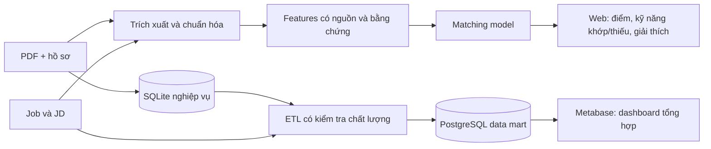

# Kế hoạch hoàn thiện TH3 — AI và BI

Ngày lập: 04/11/2026. Trạng thái: đã triển khai phần code/infrastructure trong repository; các mục cần dữ liệu/nhãn do người đánh giá vẫn là công việc nghiệm thu mở. Xem [verification](../guides/verification.md), [requirements/ERD](../guides/requirements-and-data.md) và [BI/recovery](../guides/bi-and-recovery.md) để đối chiếu bằng chứng chạy thật.

## 1. Mục tiêu và phạm vi

Hoàn thiện năm checklist TH3 bằng chức năng có thể chạy và bằng chứng tái lập:
phân tích yêu cầu/CSDL; phân tích CV và matching; dashboard BI; frontend/API;
kiểm thử và báo cáo chất lượng gợi ý. Lộ trình học và phỏng vấn Gemini đã có,
được giữ như phần bổ trợ, không thay cho đánh giá matching.

Mốc hiện tại: Next.js + API + AI + SQLite + PostgreSQL mart + Metabase chạy Docker; matching hybrid-v2
huấn luyện/đánh giá trên 10 mẫu cùng fixture; BI nội bộ và CSV; Gemini coaching;
43 test backend/AI, E2E 28 ca trên desktop/mobile (một ca Gemini transient được chạy riêng lại thành công).

Không đặt mục tiêu đảm bảo điểm chấm, accuracy 90% hoặc thu thập toàn bộ TopCV.
Không mở rộng voice/AST/GNN/email/calendar trong đợt này.

## 2. Quyết định kiến trúc đề xuất

- Giữ SQLite cho tài khoản, CV, ứng tuyển, lịch và coaching; migration có version,
  backup và kiểm thử dữ liệu cũ. Không chuyển toàn bộ OLTP sang PostgreSQL trong đợt này.
- Chuẩn hóa dữ liệu dùng trong matching/BI qua bảng/cột và lớp chuyển đổi có kiểm thử;
  giữ đọc dữ liệu JSON cũ để không mất dữ liệu đã có.
- Thêm PostgreSQL cho data mart và Metabase trong Compose; lưu cấu hình Metabase
  trong database riêng, không dùng database ứng dụng BI làm data mart.
- ETL idempotent từ SQLite và job import vào mart; báo lỗi và freshness công khai.
- Metabase đọc các view tổng hợp bằng role read-only, không chứa CV/email/số điện thoại.
  Dashboard doanh nghiệp riêng trong web tiếp tục kiểm tra owner bằng API.
  Tài khoản Metabase chỉ được cấp đúng dữ liệu/phạm vi; không public embed funnel riêng.
- Gemini `gemini-3.5-flash-lite` xử lý trích xuất có cấu trúc, giải thích và coaching.
  Matching hàng loạt dùng features/cache và model local; không gọi LLM cho từng
  job trong mỗi lần tải danh sách.
- Tách môi trường test bằng Compose project/volume riêng để test không ảnh hưởng BI demo.
- Phiên bản image/dependency được chọn và pin khi triển khai, không dùng `latest` để bàn giao.

Luồng mục tiêu:

## 3. Backlog theo thứ tự thực hiện

### Giai đoạn A — Yêu cầu, dữ liệu và thiết kế (Checklist 1)

- [ ] A1. Viết ma trận yêu cầu chức năng/phi chức năng và use case cho student/recruiter.
  Mỗi yêu cầu có API, màn hình, test và bằng chứng nghiệm thu tương ứng.
- [ ] A2. Cập nhật ERD, data dictionary, kiến trúc và luồng dữ liệu đúng code hiện tại,
  gồm skill index, predictions, stage events, learning plans, coaching questions và mart.
- [ ] A3. Thiết kế migration/backfill và backup/restore; đánh dấu nguồn dữ liệu
  `real`, `demo`, `test` rõ ràng thay vì chỉ suy luận từ tên/email.
- [ ] A4. Chốt định nghĩa metric: ứng viên duy nhất hay đơn ứng tuyển, grain mỗi bảng,
  job còn hiệu lực, thời điểm post/crawl, lương và mẫu số conversion.

Nghiệm thu: tài liệu/schema thống nhất; nâng DB cũ không mất CV/ứng tuyển;
snapshot CV đã nộp và owner access vẫn đúng; phân loại dữ liệu có thể kiểm tra lại.

### Giai đoạn B — Chất lượng dữ liệu job/CV (Checklist 1, 2, 3)

- [ ] B1. Chuẩn hóa job title/category/location/skills, source/sourceUrl/sourceId,
  postedAt/observedAt/validThrough, active state và dữ liệu thiếu. Deduplicate theo
  ID nguồn và kiểm tra thêm tin gần trùng; không xóa ứng tuyển theo tin cũ.
- [ ] B2. Chuẩn hóa salary_min/max, currency, period, negotiable, parser status.
  USD/VND và tháng/năm phải được phân biệt; số mơ hồ không được tự nhân thành triệu.
  Nếu quy đổi tiền tệ, lưu nguồn/ngày/tỷ giá; nếu chưa có, thống kê tách theo tiền tệ.
- [ ] B3. Chuẩn hóa skill aliases chung cho CV/JD/BI; thay thế index cũ khi hồ sơ
  hoặc CV hiện hành thay đổi, tránh giữ kỹ năng đã bị gỡ.
- [ ] B4. Tạo báo cáo coverage: số job, tỷ lệ có lương, ngày đăng, kỹ năng, nguồn,
  duplicate và lỗi parser. Lưu raw snapshot phục vụ đối chiếu theo chính sách dữ liệu.
- [ ] B5. Dùng ITviec đã truy cập được. TopCV chỉ thêm qua truy cập/feed được phép;
  khi 403 phải ghi trạng thái thiếu nguồn, không tạo dữ liệu giả mang nhãn TopCV.

Nghiệm thu: bảng case lương VND/USD/tháng/năm/thỏa thuận/một phía/không đọc được
cho kết quả mong đợi; import/ETL chạy lại không tăng bản sao; BI không tính test data.

### Giai đoạn C — Phân tích CV/JD có cấu trúc (Checklist 2, 4)

- [ ] C1. Thiết kế schema extraction: skills, kinh nghiệm và bằng chứng, học vấn,
  dự án, thông tin chưa xác định, extractor/model version. Thiếu dữ liệu phải là unknown.
- [ ] C2. Nối pipeline PDF text với Gemini extraction thực tế, trả kết quả có schema
  và vị trí/câu văn bằng chứng. Lưu snapshot extraction theo phiên bản CV; không ghi đè
  hồ sơ người dùng tự khai báo nếu chưa được xác nhận.
- [ ] C3. Xử lý phủ định và ngữ cảnh (chưa biết/đang học/đã làm); JD tách must-have,
  nice-to-have, seniority và yêu cầu kinh nghiệm. Cho phép chỉnh extraction và tính lại.
- [ ] C4. Thêm OCR cho PDF không có text, giữ giới hạn file/trang/timeout;
  báo riêng trạng thái upload, extraction và OCR. File lưu thành công không đồng nghĩa phân tích xong.
- [ ] C5. Cache extraction theo content hash + model/schema version; có retry có giới hạn,
  theo dõi lỗi và hiển thị provider/fallback thực tế. Không gửi cả kho CV khi duyệt job.

Nghiệm thu: test PDF có chữ/scan/font lỗi/phủ định/Việt-Anh/thiếu kinh nghiệm;
không bịa bằng chứng; giao diện xác nhận dữ liệu; thay CV làm matching cập nhật,
CV/extraction của đơn đã nộp vẫn được giữ nguyên.

### Giai đoạn D — Dataset, model và đánh giá độc lập (Checklist 2, 5)

- [ ] D1. Lập labeling guide cho relevance 0/1/2, skill evidence và must-have;
  đặt mục tiêu vài trăm cặp CV–JD đa dạng theo khả năng gán nhãn của nhóm.
  Đây là mục tiêu thu thập, không phải số mẫu hiện đã có.
- [ ] D2. Tách train/validation/test trước tối ưu; kiểm soát cùng ứng viên, job,
  công ty/template gần trùng giữa các tập. Lưu manifest/split seed/hash có version.
- [ ] D3. Gold validation/test được người đánh giá độc lập gán nhãn và xử lý bất đồng.
  Nhãn Gemini/synthetic hỗ trợ train phải đánh dấu weak/synthetic, không dùng làm
  bằng chứng ground truth độc lập cho cùng model.
- [ ] D4. Đóng băng baseline hybrid-v2. Thực nghiệm TF-IDF/cosine và model xếp hạng
  hoặc relevance classifier dùng skill coverage, must-have/nice-to-have, semantic features,
  kinh nghiệm và độ chắc chắn của extraction; học hệ số từ train, chọn bằng validation.
  Không chốt trước trọng số phần trăm hoặc chọn model theo test score.
- [ ] D5. So sánh cùng held-out set: Precision@5, Recall@5, NDCG@5, macro-F1
  nếu dùng relevance classes, phân tích theo nhóm ngành và độ trễ. Báo confidence/variation
  khi mẫu nhỏ; phân tích false positives/negatives và ablation từng nhóm features.
- [ ] D6. Version artifact, feature schema, dataset và giải thích score. Điểm là độ phù hợp
  tham khảo, không phải xác suất được tuyển. Nếu model mới không cải thiện, giữ baseline
  tốt hơn và báo đúng kết quả thay vì thay model chỉ vì mới hơn.

Nghiệm thu: một lệnh tái tạo báo cáo đánh giá; train và test độc lập; nhãn có nguồn;
bảng so sánh baseline/cải tiến và các ví dụ sai có phân tích; E2E xanh không được thay
cho bằng chứng model accuracy. Chất lượng gold labels cần phần việc của người gán nhãn.

### Giai đoạn E — Data mart và BI thật (Checklist 3)

- [ ] E1. Xây mart có grain rõ: job observations, candidate-skill snapshot,
  application và stage events; dimension time, skill, category/location/source;
  snapshot số liệu không trộn trạng thái hiện tại với lịch sử.
- [ ] E2. ETL bằng SQL/Python có watermark/upsert, refresh thủ công và theo lịch;
  xử lý bản ghi cập nhật/hết hạn, lỗi dữ liệu, idempotency và metadata freshness.
- [ ] E3. Chạy PostgreSQL + Metabase trong Compose, volumes bền, read-only credentials,
  bootstrap dashboard có thể tái tạo từ máy clone mới. Metabase app DB riêng với mart.
- [ ] E4. Dashboard ứng viên theo kỹ năng: số ứng viên duy nhất + tỷ lệ,
  nguồn CV/tự khai báo, không cộng trùng một người vì nhiều CV/đơn.
- [ ] E5. Dashboard lương theo tháng/quý/ngành/địa điểm: median, khoảng phân bố,
  sample size và tỷ lệ không công bố lương; tách tiền tệ/đơn vị chưa quy đổi.
- [ ] E6. Dashboard tuyển dụng: submitted → reviewing → interview → offered;
  định nghĩa conversion từng bước/tổng, khoảng thời gian/cohort và owner scope rõ.
- [ ] E7. Drill-down, lọc thời gian/ngành/địa điểm/nguồn; bảng đối soát và CSV;
  frontend có điểm truy cập BI phù hợp quyền. Báo nguồn/cỡ mẫu/freshness ngay trên dashboard.

Nghiệm thu: có dashboard Metabase thực chạy trong Docker; số trên dashboard khớp
SQL kiểm chứng; owner không đọc được funnel riêng của người khác; không có CV/PII
trong dataset BI; dữ liệu demo/test tách biệt.

Lưu ý lịch sử: không thay postedAt bằng importedAt để tạo giả biến động quá khứ.
Nếu dữ liệu chỉ đủ cho giai đoạn ngắn, ghi đúng phạm vi và bắt đầu snapshot từ hiện tại;
dữ liệu lịch sử synthetic chỉ dùng minh họa, phải có nhãn riêng.

### Giai đoạn F — Giao diện/API và đóng gói (Checklist 4)

- [ ] F1. CV analysis panel: trạng thái lưu/đang đọc/OCR/xong/lỗi, skills và bằng chứng,
  thông tin thiếu, xác nhận/chỉnh sửa. Lỗi upload vẫn hiện cố định.
- [ ] F2. Matching detail: model version, điểm và các yếu tố, matched/missing/must-have,
  evidence trong CV/JD, confidence/unknown. Không hiển thị xác suất được tuyển.
- [ ] F3. BI thêm số lượng người, time series, filter và freshness; đồng nhất thuật ngữ
  và cỡ chữ; UI không mô tả tính năng chưa có như tính năng đang chạy.
- [ ] F4. Phân trang/search/filter phía server cho job/candidate, cache feature/prediction
  và timeout/fallback rõ ràng; giữ snapshot điểm khi nộp hồ sơ.
- [ ] F5. Chuẩn hóa `.env.example`, Docker healthcheck, bootstrap/refresh-data/test scripts;
  clone mới chạy ứng dụng và BI bằng một đến hai script. Secrets không vào Git/image/log.

Nghiệm thu: đăng nhập → CV → xác nhận phân tích → matching → nộp → recruiter review
→ funnel/BI chạy trên desktop/mobile, có trạng thái rỗng/lỗi và phân quyền đúng.

### Giai đoạn G — QA, báo cáo và nghiệm thu (Checklist 5 và toàn bộ)

- [ ] G1. Unit/integration: migrations, extraction/OCR, phủ định, parser lương,
  dedup, feature/model contracts, test/demo exclusion, ETL/idempotency và metric SQL.
- [ ] G2. E2E Docker: giữ coverage 22 ca hiện có; bổ sung analysis panel/chỉnh extraction,
  matching explanation, BI tool/filter/time series, quyền, refresh và persistence.
- [ ] G3. Chạy E2E trên project/volume riêng; kiểm tra 0 test data trong BI nghiệp vụ,
  không xóa job/CV thật; ghi artifacts, screenshots, trace và thời điểm chạy.
- [ ] G4. Kiểm thử clone mới không phụ thuộc volume cũ; restart/backup/restore;
  health, migrations và dữ liệu BI giữ qua restart. Pin model/runtime/dependency version.
- [ ] G5. Viết báo cáo đồ án: yêu cầu/ERD/kiến trúc, dataset/nhãn/split, thuật toán,
  thực nghiệm, model errors, BI metrics/insights, test results, hạn chế và hướng phát triển.
- [ ] G6. Chuẩn bị kịch bản demo và ma trận bằng chứng 5 checklist; kiểm tra mọi tuyên bố
  trong báo cáo khớp code, dữ liệu và artifacts của bản bàn giao.

## 4. Phụ thuộc và các mốc bàn giao

| Mốc | Phụ thuộc | Đầu ra có thể nghiệm thu |
| --- | --- | --- |
| M1 — Dữ liệu đáng tin | A → B | Requirements/ERD, migration, salary/skill normalization, data-quality report |
| M2 — AI có bằng chứng | A/B → C → D | CV analysis, dataset/splits, model artifacts và báo cáo held-out |
| M3 — BI thực | M1 → E | Mart/ETL, dashboard Metabase, đối soát SQL, cô lập dữ liệu test |
| M4 — Bản nộp | M2 + M3 → F/G | UI/API hoàn chỉnh, Docker bootstrap, E2E và báo cáo cuối |

Có thể làm labeling và cấu hình BI trong thời gian phát triển extraction, nhưng
chưa được tuyên bố chất lượng model trước khi có gold test độc lập.

Ước lượng ban đầu: 12–18 ngày công phát triển/kiểm thử cho phạm vi này, chưa tính
thời gian chờ dữ liệu và người gán nhãn. Cần hiệu chỉnh sau M1; không phải cam kết
ngày hoàn thành. Vai trò cần có: backend/data, AI/evaluation, frontend/QA và người gán nhãn.

## 5. Điều kiện chốt bản nộp

- [ ] Cả năm checklist có đầu ra chạy được và tài liệu/bằng chứng tương ứng.
- [ ] Matching được đánh giá trên held-out test, không lặp lại lỗi train=evaluation.
- [ ] Dashboard có đúng số ứng viên theo kỹ năng, lương theo thời gian và conversion.
- [ ] Công cụ BI chạy thực, dữ liệu được đối soát và không bị test fixtures làm lệch.
- [ ] Docker từ clone mới khởi động bằng script đã hướng dẫn, không cần dữ liệu bí mật từ máy dev.
- [ ] Backend/E2E/build đạt; test hiệu quả model là báo cáo riêng, không trộn với E2E.
- [ ] Đã xác minh backup/restore, phân quyền và không mất dữ liệu hiện có.
- [ ] Hạn chế (OCR, nguồn lịch sử, labels, độ chính xác, nguồn bị chặn) được ghi trung thực.

## Tài liệu kiểm tra phương án BI

- [Metabase Docker](https://www.metabase.com/docs/latest/installation-and-operation/running-metabase-on-docker)
- [Metabase PostgreSQL connection](https://www.metabase.com/docs/latest/databases/connections/postgresql)

Tài liệu chính thức xác nhận có image Docker và hỗ trợ PostgreSQL; kiến trúc mart,
quyền truy cập và lộ trình triển khai ở đây là đề xuất riêng cho repository này.
